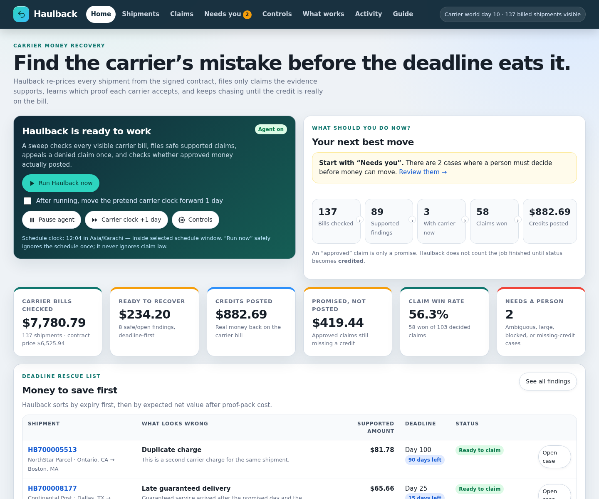
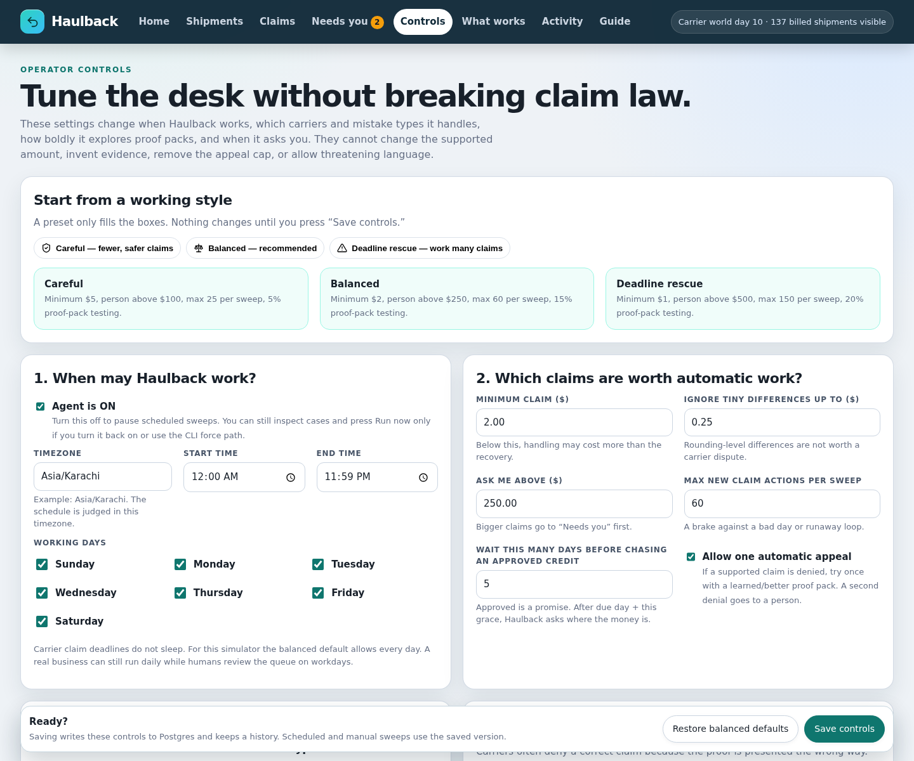
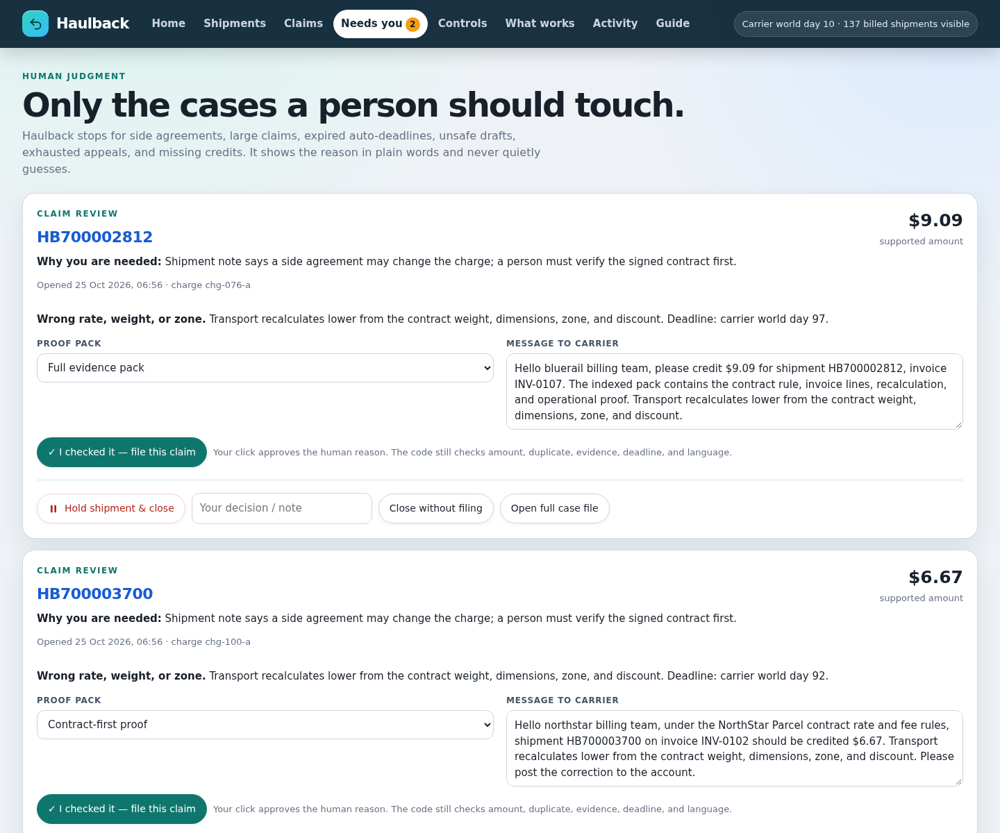
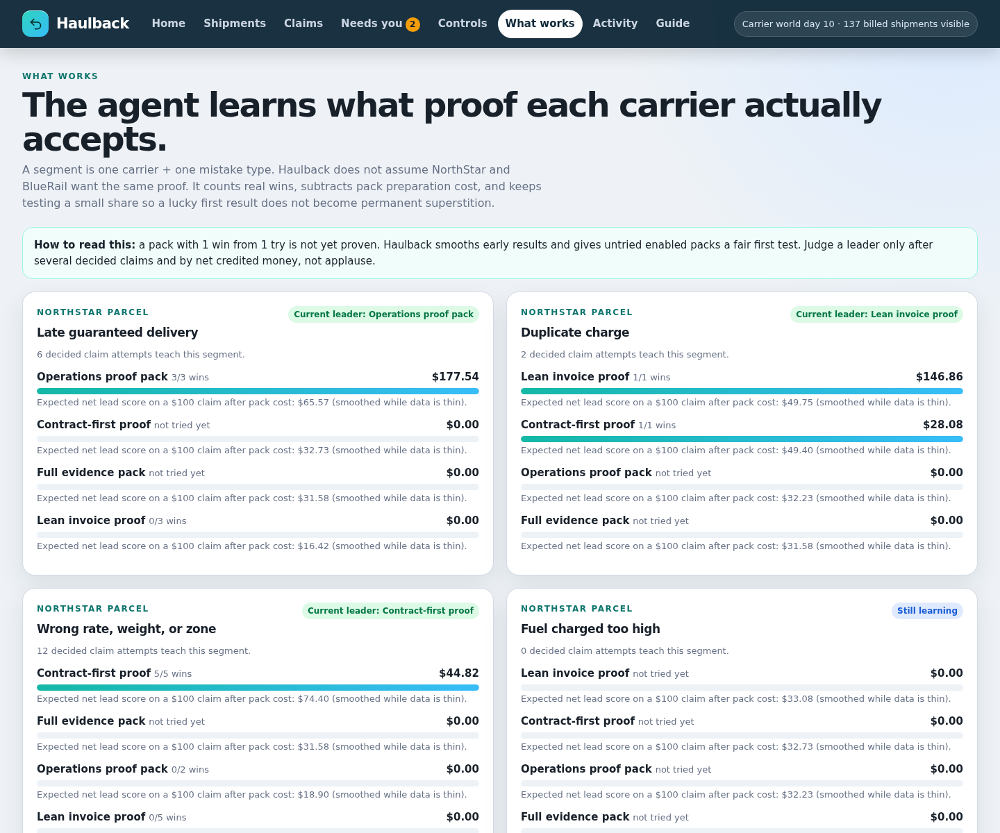

# Haulback

**A carrier-overcharge recovery agent for businesses that ship physical goods.**

Haulback re-prices every billed shipment from the signed carrier contract, files only evidence-supported claims before their deadlines, learns which proof pack each carrier accepts for each kind of mistake, appeals a bad denial once, and reconciles every approved credit until the money actually posts.

The commercial outcome is not a report. It is a **posted carrier credit**.



> Screenshots show the seeded fictional carrier world included for evaluation. They are not presented as results from a real carrier account.

## Why this exists

Carrier invoices are easy to under-audit and expensive to work late:

- the billed weight, zone, fuel percentage, or accessorial fee may not match the contract;
- a guaranteed service can arrive late, but the claim window can be short;
- the same shipment can be billed twice, or a label can be billed without being tendered;
- carriers can deny a mathematically supported claim because the proof is packaged poorly;
- “approved” is not the same as money back — an approved credit still has to post.

Most audit software can find discrepancies. Haulback is built around the whole recovery loop:

1. **Recalculate** the shipment deterministically from contract and shipment facts.
2. **Triage by deadline and expected net value**, not by invoice order.
3. **Choose an evidence bundle** for that carrier + claim category.
4. **Pass a code policy gate** before any carrier-facing write.
5. **File an idempotent claim** and learn from the real decision.
6. **Appeal at most once** when a supported claim is denied.
7. **Reconcile approved versus credited money** and chase missing credits.
8. **Escalate ambiguity, large claims, expired auto-claims, unsafe drafts, and exhausted appeals to a person.**

## Measured result

The repository includes a seeded Go/GraphQL carrier stand-in so the complete workflow can be measured without pretending simulator output is live carrier revenue. All three modes saw the same 240-shipment world, the same contract math, and the same hidden adjudication behaviour.

Evaluation: seed `20261025`, 75 simulated carrier days, draft mode `baseline:rules`, model cost `$0`.

| Mode | Credited | Net after handling/model | Recovery of supported pool | Initial claims | Appeals | Claim precision | Approval rate | Invalid | Missed deadlines | Approved, not credited |
|---|---:|---:|---:|---:|---:|---:|---:|---:|---:|---:|
| Do nothing | $0.00 | $0.00 | 0.0% | 0 | 0 | 0.0% | 0.0% | 0 | 32 | $0.00 |
| Simple claim-everything-once | $1,436.86 | $1,195.36 | 42.1% | 138 | 0 | 100.0% | 38.4% | 0 | 1 | $289.23 |
| **Haulback** | **$3,065.58** | **$2,552.73** | **89.8%** | 138 | 67 | **100.0%** | **63.9%** | **0** | 1 | **$0.00** |

World totals: **$13,560.35 billed**, **$11,198.69 contract-expected**, and a **$3,415.64 category-supported claim pool**.

Definitions matter:

- **Claim precision** = simulator-valid claim attempts ÷ all claim attempts, counting initial claims and appeals.
- **Approval rate** = approved-or-credited claims ÷ decided claims. A valid, supported claim can still be denied by the fictional carrier; “valid” and “approved” are different facts.
- **Net** subtracts the evaluator’s handling assumptions: $1.50 per initial claim, $2.00 per appeal, $0.25–$1.75 to prepare an evidence pack, and $0.50 per credit chase. Those are evaluator costs, not carrier prices.
- Haulback made **24 credit chases** and ended with no approved-but-uncredited balance.

Full reports:

- [`results/eval-2026-10-25T07-04-07-584Z.md`](results/eval-2026-10-25T07-04-07-584Z.md)
- [`results/eval-2026-10-25T07-04-07-584Z.json`](results/eval-2026-10-25T07-04-07-584Z.json)

## What Haulback audits

| Category | Deterministic check |
|---|---|
| Late guaranteed delivery | Guaranteed service, guarantee not suspended, delivered after the promised day |
| Duplicate charge | More than one charge record for the same shipment |
| Billed but not tendered | A billed label whose shipment was never tendered to the carrier |
| Wrong rate, weight, or zone | Billed transport differs from contract weight/dimensional weight, zone, rate, and discount |
| Fuel surcharge too high | Fuel cents exceed the contract percentage of billed transport |
| Residential fee | Home-delivery fee where the address is not residential |
| Delivery-area fee | Remote-area fee where the address is not in that surcharge class |
| Address-correction fee | Correction fee with no correction event |
| Handling fee | Extra-handling fee where no extra handling was required |

Money is handled in integer cents. The model never calculates the recovery amount.

## The safety boundary

Haulback separates **calculation**, **wording**, and **permission**:

- `src/rating.ts` calculates expected charges and supported claim amounts.
- `src/draft.ts` lets an optional model choose only a structured action, one enabled evidence bundle, carrier-facing wording, and a reason.
- `src/policy.ts` and `policy/claims.json` make the final yes/no decision in code.

The gate refuses or queues a case when:

- the recalculated amount is zero/unsupported;
- the claim is below the operator’s minimum or inside the rounding tolerance;
- the automatic deadline has passed;
- evidence for the selected bundle does not exist;
- an active or successful claim already covers the same charge/category;
- the case would require a second appeal;
- a shipment note suggests a side agreement or other contract ambiguity;
- the amount is above the human-approval threshold;
- the wording contains threats or banned pressure phrases;
- model output is malformed or tries to use an unavailable action/bundle.

Shipment notes and carrier denial text are treated as **untrusted data**, never as instructions. The test suite includes prompt-injection cases.

## Control Room

The dashboard is an operator product, not a metrics screenshot:

- **Home** — run/pause, advance the fictional carrier clock, see money by lifecycle state, and work the deadline-rescue list.
- **Shipments** — search/filter every shipment; open a case file showing billed versus contract price, claim history, decisions, and hold/release controls. A test-shipment form can create clean, late, duplicate, wrong-fee, not-tendered, rate-error, and ambiguous cases.
- **Claims** — filter submitted/approved/credited/denied claims, chase a missing credit, or mark one posted after seeing it on the bill.
- **Needs you** — approve an exact claim/appeal after human review, hold a shipment, or close a case without filing.
- **What works** — evidence-bundle wins, attempts, recovered money, and expected net value by carrier + claim category.
- **Activity** — runs, decisions, and model-call telemetry.
- **Controls** — persisted schedule, thresholds, enabled carriers/categories/bundles, exploration, appeal behaviour, model/budget, tones, and message templates. Controls cannot rewrite claim law.
- **Guide** — the built-in first-run explanation.







## Architecture at a glance

```text
GitHub Actions hourly / operator Run now
                │
                ▼
TypeScript Haulback agent ─────► Postgres agent memory
  deterministic rating             runs · decisions · claim trials
  expected-value triage            bundle stats · queue · settings
  evidence-bundle learning         model calls · suppressions
  policy gate + optional LLM
                │ GraphQL + bearer token
                ▼
Go carrier ledger stand-in
  contracts · shipments · charges · claims · credit posting · events
                │
                └────► Postgres snapshot (one authoritative writer)

TypeScript Control Room (Render/Cloud Run)
  operator UI over the same agent + ledger state
```

See [`ARCHITECTURE.md`](ARCHITECTURE.md) for the lifecycle, data model, concurrency rules, failure modes, and production-integration boundary.

## Run it locally

### Option A — Docker Compose

Requirements: Docker Desktop or Docker Engine with Compose.

```bash
LEDGER_TOKEN='choose-a-long-local-token' \
REVIEW_PASSWORD='choose-a-local-dashboard-password' \
docker compose up --build
```

Open:

- Control Room: <http://localhost:8080>
- Ledger health: <http://localhost:8090/healthz>

Sign in as user `operator` with the `REVIEW_PASSWORD` you supplied. Start on **Home**, press **Run Haulback now**, then use **Carrier clock +1 day** to move the fictional carrier through decisions and credit posting.

Stop it with Ctrl+C. Remove the local database volume only if you intentionally want to erase the local world:

```bash
docker compose down -v
```

### Option B — Native development processes

Requirements: Node 22+, Go 1.27+, and a reachable Postgres database.

Terminal 1 — Go carrier ledger:

```bash
cd ledger
DATABASE_URL='postgres://...' LEDGER_TOKEN='local-token' PORT=8090 go run .
```

Terminal 2 — Control Room and agent:

```bash
npm ci
DATABASE_URL='postgres://...' \
LEDGER_URL='http://localhost:8090/graphql' \
LEDGER_TOKEN='local-token' \
npm run serve
```

In non-production mode with no `REVIEW_PASSWORD`, the dashboard is intentionally open for local development. In production mode it fails closed: `/` returns Basic-auth `401` until a password is configured and supplied.

Useful CLI commands:

```bash
npm run cli -- stats
npm run cli -- audit --limit 20
npm run cli -- sweep --model baseline:rules --advance-days 1
npm run cli -- claims --status denied
npm run cli -- queue
```

## Permanent free deployment

The supported no-card deployment is:

- **GitHub** — source code and CI;
- **Neon Postgres** — durable agent memory and ledger snapshot;
- **Render free web services** — `haulback-ledger` and `haulback-review`;
- **GitHub Actions** — hourly unattended sweep at minute 37.

Follow [`DEPLOYMENT.md`](DEPLOYMENT.md) exactly. It includes the repository, Neon, Render, GitHub-secret, first-controls, proof, day-to-day operation, and troubleshooting steps.

An optional, explicitly unrun Google Cloud path is in `deploy/gcp.sh` and `deploy/cloudbuild.yaml`. It deploys the same containers to Cloud Run and the hourly job to Cloud Scheduler, but Google Cloud requires a billing account; it is not part of the no-card route.

## Evaluation

> **Never run the evaluator against a live ledger or live database.** It resets its target world. Use a throwaway Postgres database and an in-memory ledger, as `.github/workflows/eval.yml` does.

The evaluator compares:

- `none` — no claims;
- `simple` — one cheapest-bundle claim for every supported finding, no learning, no appeals, no credit chasing;
- `haulback` — deadline/value triage, learned bundles, one appeal, and credit reconciliation.

Manual isolated run shape:

```bash
HAULBACK_EVAL_CONFIRM=reset-world \
DATABASE_URL='postgres://...throwaway...' \
LEDGER_URL='http://localhost:8091/graphql' \
npm run eval -- --draft-model baseline:rules --seed 20261025 --days 75
```

The GitHub **haulback-eval** workflow is manual-only and uses isolated services.

## Model swapping

`baseline:rules` is the free, deterministic default. Optional structured-tool drafting providers are selected with the same `provider:model` shape:

- `grok:<model>` (`XAI_API_KEY`)
- `Claude:<model>` (`ANTHROPIC_API_KEY`)
- `openai:<model>` (`OPENAI_API_KEY`)
- `oss:<model>` against an OpenAI-compatible `OSS_BASE_URL` (`GROQ_API_KEY` in the provided configuration)

Examples and local price assumptions live in `models.json`; update them before interpreting a paid-model run. A model can draft or suggest a bundle. It cannot change the supported amount, invent evidence, extend a deadline, duplicate a claim, or approve itself past the policy gate. Every attempted/successful model call records tokens, estimated cost, latency, and errors. The sweep stops after the operator’s model-spend budget.

## Tests

```bash
npm ci
npm run check
npm test
npm run build
node dist/src/cli.js --help

cd ledger
gofmt -l .
go vet ./...
go test ./...
```

CI additionally builds both production Docker images.

## Failure modes and kill criteria

Haulback should be paused and investigated if any of these occur:

- an automatic claim is filed after deadline or above the deterministic supported amount;
- invalid/unsupported claims exceed 2% of filed attempts;
- approved-but-uncredited money grows while credit chases stop working;
- the policy gate starts queuing ordinary cases because source data quality collapsed;
- a carrier changes claim rules/evidence formats and adapters have not been updated;
- bundle learning repeatedly chooses expensive packs without improving net credited recovery.

Kill/rollback rule: **do not keep Haulback if net credited recovery after handling and model cost does not beat the simple baseline, if claim precision falls below 98%, or if bundle learning cannot beat always using the cheapest bundle after costs.** The current seeded run passes those tests; a future run that fails them is evidence to stop, not material for a better chart.

## Production boundary

This repository is a complete agent against a faithful, seeded carrier system of record. It is not a claim that a real UPS/FedEx/DHL account was audited. A production rollout replaces the Go ledger with read/write adapters for:

- carrier invoice/EDI and tracking APIs;
- ERP/TMS shipment, package, address-classification, and tender records;
- signed contract rate tables, incentive tiers, fuel tables, and guarantee terms;
- carrier claim portals/APIs and credit-memo feeds;
- customer identity, SSO, multi-tenancy, retention, and audit requirements.

The deterministic rater, policy gate, claim-trial memory, evidence learning, appeal cap, human queue, evaluator, and credit-reconciliation loop are the reusable product core.

## Repository map

| Path | Purpose |
|---|---|
| `src/rating.ts` | Contract recalculation and supported findings |
| `src/policy.ts`, `policy/claims.json` | Claim law and banned language |
| `src/strategy.ts` | Evidence bundles, expected value, exploration, deadline-first ordering |
| `src/draft.ts`, `src/models.ts` | Baseline templates and optional structured model drafting |
| `src/engine.ts`, `src/sweep.ts` | Claim/appeal/credit lifecycle and locked unattended sweep |
| `src/server.ts` | Control Room |
| `src/db.ts`, `db/migrations/` | Postgres agent memory |
| `src/evaluate.ts` | Guarded `none` vs `simple` vs `haulback` benchmark |
| `ledger/` | Go/GraphQL fictional carrier system of record |
| `.github/workflows/` | Tests, hourly sweep, isolated manual evaluation |
| `deploy/`, `render.yaml`, `docker-compose.yml` | Container and cloud deployment |
| `results/` | Canonical evaluation reports |

## Licence / status

Portfolio and evaluation software. No licence is granted for production carrier claims until the carrier-specific adapters, contract terms, evidence retention, and account-authorisation controls for a real shipper have been implemented and reviewed.
